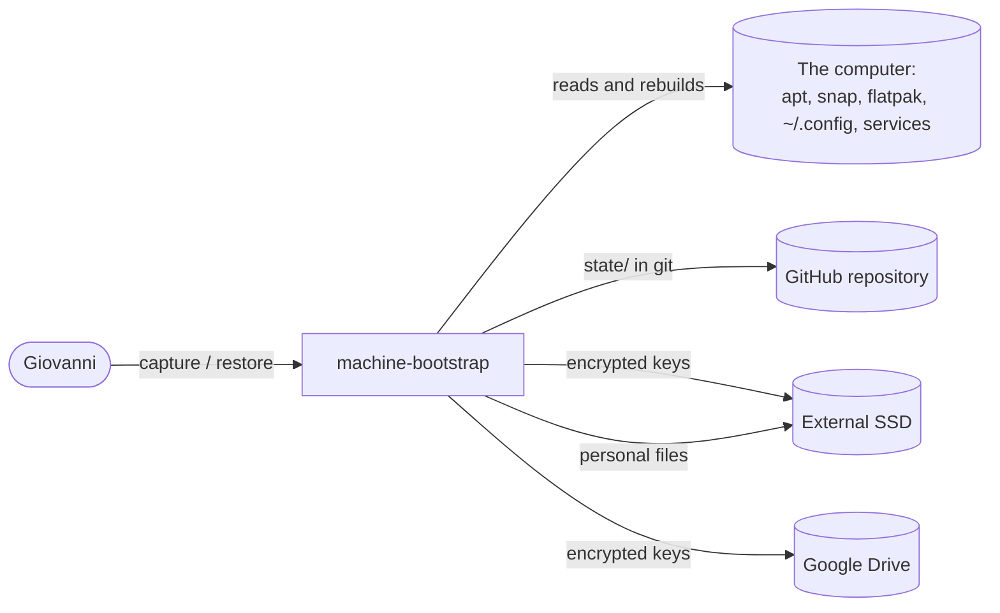
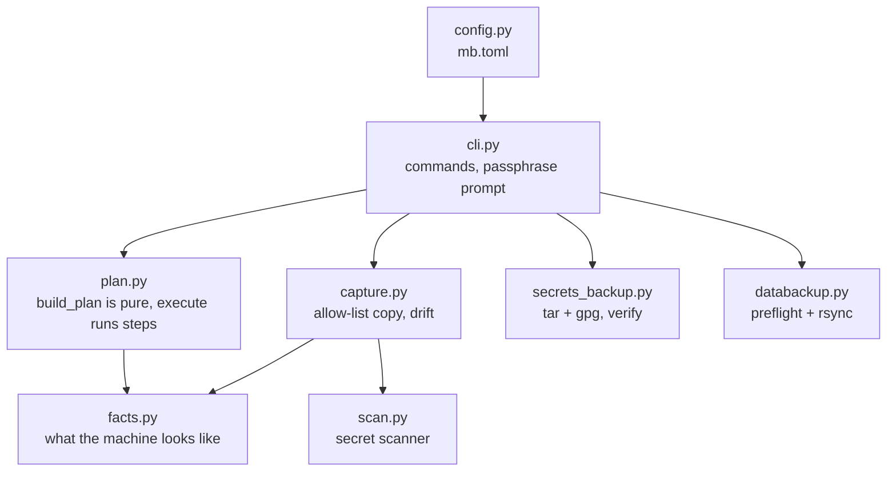
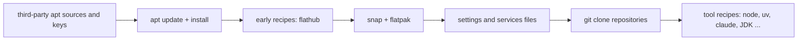

# machine-bootstrap: design and development decisions

What the system is, how it is built and why. Living document: updated in the same commit as the change.

Last updated: 2026-10-26

## 1. What it is

A tool that records how Giovanni's computer is set up and rebuilds that setup on a fresh install or on another
computer: packages, settings, services, tools, repositories, keys and personal files. It exists so that formatting the
PC, or moving to a new one, is one command and one passphrase instead of days of remembering. The runbook for the day
it is needed is `docs/RESTORE.md`. Language: Python (standard library only) plus a Bash starter
([ADR-0002](docs/adr/0002-python-stdlib-and-bash.md)).

## 2. Architecture

### System context (C4 level 1)

### Containers and modules (C4 level 2)

`state/` (generated, kept in git) is what `capture` writes and `plan` reads. The plan is built from `state/` plus a `Facts`
object, so tests use a fake machine and never touch the real system. What enforces it: `execute` takes the command
runner as a required argument (the CLI passes the real one, tests pass a fake that fails the test if it is called).

### Restore order (what `mb restore` does)

Dry run by default. Boot-loader packages are never installed; with `--profile new` hardware-bound packages and files are
skipped too. A package the new Ubuntu no longer has is reported and skipped, it does not stop the others.

## 3. Testing

See `docs/REQUIREMENTS.md` and `tools/quality_gate.sh` (unit tests, shellcheck, secret scan of `state/`, traceability,
fitness limits). The proof that a whole restore works on a bare system is `tools/vm-test.sh` (QEMU, fresh Ubuntu cloud
image, about an hour); its result is recorded in the decision log below (MB-15). Unit tests prove the logic; only the VM
proves the recipes and download URLs, and those rot: re-run the VM test after changing a recipe and at least every few months.

## 4. Decision log

Newest first. **Type** is the ISO/IEC/IEEE 14764 maintenance category: *corrective* (fixes a defect), *adaptive*
(follows an outside change), *perfective* (new or better feature), *preventive* (lowers a future risk) or *initial*.

| Date | Type | Decision | Why |
|---|---|---|---|
| 2026-10-26 | Adaptive | Publish the personal rclone OAuth privacy notice in `docs/PRIVACY.md`; use this public repository as the application homepage. | Google requires homepage and privacy URLs before enabling production status, which avoids the seven-day authorization lifetime of testing mode. Giovanni authorized the Google policy and full Drive scope; credentials stay private. |
| 2026-10-26 | Preventive | Require GitHub Actions `gate` on main, including administrators; disallow force pushes and branch deletion. Add GitHub CI and protection checks to `pipeline-check.toml`. | Giovanni added GitHub protection to bootstrap scope; the local report must verify the live settings instead of omitting them. |
| 2026-10-26 | Corrective | Mark `dev/env.sh` as sourced Bash, quote the home path and separate command assignments from exports; update the live source and its captured copy together. | The first GitHub run found an unknown shell (SC2148) and masked command status (SC2155) in captured `dev/env.sh`. Before the initial commit, the scanner saw only explicitly configured files because its automatic list comes from git. |
| 2026-10-26 | Adaptive | Publish the existing source, settings and package lists as `yujideluca/machine-bootstrap`, a public repository. Secret scanning and the local gate run before publication; the exact commit must pass GitHub Actions before reaching main. | Giovanni explicitly chose public visibility. Encrypted archives and credentials stay outside git. |
| 2026-10-25 | Preventive | **VM proof** (MB-15): `tools/vm-test.sh` on a clean Ubuntu 26.04 cloud image, `bootstrap.sh --apply --profile new`: ALL CHECKS PASSED (27 checks: 405 settings files identical, second run has nothing pending, public repositories cloned, Chrome and Tailscale installed from the restored apt sources, uv, Node, Claude Code, Codex, Rust, Elm 0.19.1, pyright, JDK 21, Gradle, Android SDK, the wiki server and site built, secrets round trip, drive guard). **Not proven**: cloning the two private repositories (`codex-pbar`, `project-template`) because that needs the real SSH key; and the real passphrase-protected archive. Four runs were needed; the first three each found a real gap (see the rows below) | Giovanni: this tool is the bridge to another setup, so "it works" must be shown on a bare system, not assumed |
| 2026-10-25 | Corrective | **Settings are written last, after the tool installers**; **recipes run with `~/.local/bin` and `~/.cargo/bin` on PATH**; **`~/dev/env.sh` is captured**; **Elm is pinned to 0.19.1** and the wiki recipe is done only when the site is built; pyright installs the way this laptop has it (pip target + wrapper) | VM runs 1-3: uv/rustup/claude append to `.bashrc` so a second run saw it as changed; `npm` was not found; JDK/Gradle/SDK setup failed without `env.sh`; the wiki refused Elm 0.19.3 |
| 2026-10-25 | Corrective | **Restore plans twice when new apt sources were added** (`apply_plan`) | VM run 1: Chrome, Tailscale and ChatGPT were judged "not available" because the plan was made before their sources existed |
| 2026-10-25 | Corrective | **A command that is not installed (`flatpak`, `snap`) means "nothing installed", not a crash** | The first clean-VM run died in the dry run: a fresh Ubuntu has no `flatpak`. Only the VM could find it |
| 2026-10-25 | Preventive | **Boot-loader packages are never installed by restore** (`never_packages`), found while reading the captured package list (`grub-pc`, `grub-efi-*`, `shim-signed` are all listed as manual) | Installing `grub-pc` over `grub-efi` on a fresh system could leave it unbootable |
| 2026-10-25 | Corrective | **`execute` requires an explicit runner**: a test once ran a real recipe (`curl`) because the default was the real runner | A test must never touch the system |
| 2026-10-25 | Initial | **Project started** from `~/dev/project-template`; Python (stdlib) + Bash ([ADR-0002](docs/adr/0002-python-stdlib-and-bash.md)); allow-list capture with secret scanner ([ADR-0004](docs/adr/0004-allow-list-and-scanner.md)); keys in a passphrase-encrypted archive on the SSD and Google Drive ([ADR-0005](docs/adr/0005-secrets-passphrase-two-places.md)) | Giovanni: moving to another computer must not be troublesome, and the tool "should be taken very seriously, because it will be the bridge to another setup" |

## 5. Known limitations

Tracked as GitHub Issues labelled `debt` (see `docs/MAINTENANCE.md`) once the repository exists. Today: browser profiles, the
wiki server build and game installs are not covered (listed in `docs/RESTORE.md`); a tool recipe is only proven by the VM run.
